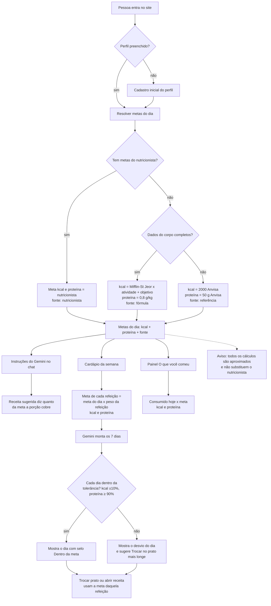

# Plano de implementação: metas do nutricionista, aviso dos cálculos e visual novo

Data: 2026-10-27. Status: feito (D60, D61 e D62 em `docs/decisoes.md`).

## Objetivo

1. A pessoa informa a **meta de energia (kcal/dia)** e a **meta de proteína (g/dia)** que o nutricionista passou.
   Todo prato e todo cardápio da DelícIA passa a mirar nesses dois números.
2. Uma parte explicativa diz que **todos os cálculos de gasto energético e de proteína são aproximados e não
   substituem a consulta com um nutricionista**.
3. Todas as telas ganham um visual revisado com os plugins **frontend-design** e **impeccable**.

## Fluxograma

## Fase 0. Instalar os plugins (precisa do autor)

- `frontend-design`: está no catálogo oficial da Anthropic (`anthropics/claude-plugins-official`).
- `impeccable`: **não está no catálogo** deste computador. É um projeto externo no GitHub; precisa adicionar o
  marketplace dele antes de instalar. Conferir o repositório e o que ele roda antes de instalar.
- Instalar pelo comando `/plugin` num terminal `claude` interativo e abrir uma sessão nova para os skills
  aparecerem.
- Sem os plugins, a Fase 4 não começa (as outras fases não dependem deles).

## Fase 1. Metas do nutricionista no perfil (D60)

| Onde | O que muda |
|---|---|
| `supabase/007_prescricao.sql` (novo) | `perfis` ganha `kcal_nutricionista int` (800 a 6000) e `proteina_nutricionista int` (20 a 400 g), ambos opcionais, com `check`. Mesmo formato do `006_preferencias.sql`. |
| `src/nutrimesa/accounts.py` | `Perfil` ganha os dois campos; `save_profile`/leitura tratam como os campos de preferência (`_CAMPOS_...`), com o mesmo aviso se a coluna ainda não existir. |
| `src/nutrimesa/energy.py` | Função nova `daily_targets(est, peso_kg, kcal_nutri, proteina_nutri)` que devolve `(kcal, proteina_g, fonte)` seguindo o fluxograma. Constantes `PROTEINA_G_KG = 0.8` (RDA para adultos, IOM 2005) e `REFERENCIA_PROTEINA_G = 50` (Anvisa IN 75/2020), com fonte no docstring como as outras. |
| `app.py` `pagina_perfil` | Bloco novo no formulário: **"Metas do seu nutricionista (opcional)"**, dois `number_input`. Quando preenchido, o painel de estimativa mostra as duas metas com o selo "definida pelo nutricionista" e a fórmula fica só como comparação. |
| `app.py` `_meta_kcal` | Troca por `_metas(perfil)` que chama `daily_targets`; todos os usos (`_novo_chat`, `_painel_consumo`, `pagina_cardapio`) passam a usar `_metas`. |
| `TEXTO_CONSENTIMENTO` | Cita as metas do nutricionista entre os dados guardados e enviados ao Gemini. |

Regra: a meta do nutricionista **vence sempre** a fórmula, inclusive o piso de 1.200/1.500 kcal e o bloqueio de
"perder peso com IMC abaixo de 18,5" (quem prescreveu é o profissional). A tela só avisa se o número estiver
fora da faixa aceita no banco.

## Fase 2. Tudo mira nas metas (D61)

| Onde | O que muda |
|---|---|
| `chat.py` `set_profile` / `COM_PERFIL` | Recebe `proteina_g` e `fonte`. Linhas novas nas instruções: meta de proteína e de onde ela vem. Instrução: "ao sugerir uma receita, diga quanto da meta de kcal e de proteína do dia 1 porção cobre". |
| `planner.py` `_pedido_semana` | Cada refeição sai com "cerca de X kcal e Y g de proteína". Reusa `meal_targets` (já é genérica: serve para proteína com os mesmos pesos). |
| `planner.py` `build_week` | Recebe `proteina_g` e `fonte`; o plano guarda `meta_proteina_g` e `fonte_meta` (no lugar de `meta_e_referencia`, que continua sendo lido para planos antigos em `restore`). |
| `planner.py` (função nova `day_check`) | Compara `day_totals` com as metas: kcal dentro de ±10% e proteína ≥ 90%. Devolve o desvio para a tela. Sem nova chamada automática ao modelo. |
| `planner.py` `swap_meal` | Pede o prato novo com a meta de kcal **e** de proteína daquela refeição. |
| `app.py` `_dia` | Mostra "previsto X kcal · Y g proteína" por prato e um selo por dia: "Dentro da meta" ou "Proteína 18 g abaixo; troque o prato mais longe". |
| `app.py` `_receita_do_prato` | O pedido da receita leva a meta da refeição, para as quantidades baterem com o cardápio. |
| `app.py` `_painel_consumo` | Proteína também mostra "sua meta: Y g", e as duas metas mostram a fonte. |
| `planner.py` `to_excel` | Aba Observações cita as duas metas e a fonte; "Totais por dia" ganha a coluna de desvio. |

## Fase 3. Parte explicativa dos cálculos

- Página nova **"Como calculamos"** no menu da barra lateral (entre Meu perfil e Configurações), texto em
  `app.py` como o `TEXTO_CONSENTIMENTO`:
  - de onde vêm as metas (nutricionista, fórmula ou referência), com as fórmulas e fontes de `energy.py`;
  - que os nutrientes dos pratos são estimativas da IA;
  - aviso destacado: **"Todos os cálculos de gasto energético e de consumo de proteínas são aproximados e não
    substituem a consulta com um nutricionista."**
- A constante `AVISO` de `energy.py` passa a ter esse texto e aparece, curta e com link para a página, no
  perfil, no cardápio, no painel de consumo, na tela de entrada e na planilha.

## Fase 4. Visual de todas as telas (com os plugins)

Telas: entrada (`tela_entrada`, `_abas_de_acesso`), barra lateral, conversa, perfil, cardápio, configurações e a
página nova "Como calculamos".

1. Rodar o skill do **impeccable** como auditoria em cada tela (no navegador, com o site local) e listar os
   problemas.
2. Usar o **frontend-design** para definir a direção visual (tipografia, cores, espaços, componentes) mantendo a
   marca atual (`visual.wordmark`, ilustrações).
3. Aplicar no que o Streamlit permite: `src/nutrimesa/visual.py` `page_css`, `.streamlit/config.toml` (tema
   claro e escuro) e a ordem/agrupamento dos componentes em `app.py`. Nada de trocar o Streamlit.
4. Conferir cada tela em claro e escuro, no computador e no celular (375 px), com print antes e depois.

Ordem: primeiro as fases 1 a 3 (mudam o que aparece nas telas), depois a fase 4 (para não refazer o visual).

## Testes

- `tests/test_energy.py`: `daily_targets` nas três fontes, nutricionista vencendo o piso e o bloqueio de IMC.
- `tests/test_planner.py`: pedido com proteína por refeição, `day_check` dentro e fora da tolerância, `restore`
  de plano antigo (sem `meta_proteina_g`).
- `tests/test_chat.py`: instruções com a meta de proteína e a fonte.
- `tests/test_accounts.py`: leitura e gravação dos campos novos e aviso sem a coluna.

## Fica de fora (de propósito)

- Metas por refeição vindas do nutricionista (só o total do dia; a divisão segue os pesos das refeições).
- Outras metas (carboidrato, gordura, fibras, sódio).
- Recalcular o cardápio sozinho quando um dia sai da tolerância (a pessoa troca o prato).
- Upload do PDF da dieta.

## Pendência nova

22. Rodar `supabase/007_prescricao.sql` no Supabase (metas do nutricionista, D60).
